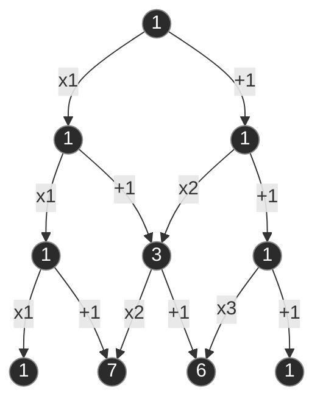

# Partizioni di un Insieme

Una **partizione** di un insieme $A$ è una suddivisione dell'insieme in sottoinsiemi (chiamati **blocchi**) che sono a due a due disgiunti e la cui unione restituisce l'insieme $A$ originario.

## Dettagli Teorici

Dal punto di vista formale, una partizione dell'insieme $A$ è una collezione di sottoinsiemi $A_1, A_2, \dots$ (che può essere sia finita che infinita) tali che:

1. **Disgiunti a due a due**: Non devono esserci elementi in comune tra due blocchi distinti. Formalmente: l'intersezione $A_i \cap A_j = \emptyset$ per ogni $i \neq j$.
2. **Copertura totale**: L'unione di tutti questi sottoinsiemi deve restituire esattamente l'intero insieme di partenza $A$. Formalmente: $\bigcup_{i} A_i = A$.
3. **Non vuoti**: I sottoinsiemi non possono essere vuoti. Formalmente: $A_i \neq \emptyset$.

### Nomenclatura Importante
- I sottoinsiemi $A_i$ prendono il nome di **blocchi**. 
- È un errore grave in sede d'esame confondere i "blocchi" chiamandoli "partizioni". La *partizione* è l'intera collezione (la suddivisione nel suo complesso), mentre i *blocchi* ne sono semplicemente gli elementi costituenti.
- L'ordine con cui si elencano i blocchi è irrilevante.

### Esempi Pratici

**Insiemi finiti:**
Dato l'insieme $A = \{1, 2, 3\}$, le partizioni possibili sono 5. Esiste sempre la partizione con un unico blocco e la partizione con singoli elementi:
- $\{1, 2, 3\}$ (un unico blocco)
- $\{1\}, \{2\}, \{3\}$ (ogni elemento forma un blocco)

In aggiunta a queste, troviamo le partizioni non banali:
- $\{1, 2\}, \{3\}$
- $\{1, 3\}, \{2\}$
- $\{2, 3\}, \{1\}$

**Insiemi infiniti:**
Dato l'insieme dei numeri interi $\mathbb{Z}$, ci sono svariati modi per partizionarlo:
- **Partizione in due blocchi (finiti ma di dimensione infinita):** Numeri Pari e Numeri Dispari.
- **Partizione in infiniti blocchi (ciascuno finito):** segmenti di $100$ numeri contigui (es. $\dots, [-99, 0], [1, 100], [101, 200], \dots$).
- **Partizione in infiniti blocchi (ciascuno infinito):** raggruppamento in base alle potenze di un singolo numero primo. Ad esempio un blocco per le potenze di $2$, uno per le potenze di $3$, e un blocco residuale per i numeri che non sono potenze di alcun numero primo.

---

## Calcolo delle Partizioni

Come anticipato, in combinatoria ci si concentra su insiemi finiti di cardinalità $N$. Quante sono, in totale, le partizioni possibili di un tale insieme? E quante sono se fissiamo a priori il numero di blocchi $K$?

### I Numeri di Bell ($B_n$)

Il numero totale di partizioni di un insieme di $n$ elementi è detto **Numero di Bell** e si indica con $B_n$.
- $B_1 = 1$ (c'è una sola partizione possibile per 1 elemento)
- $B_2 = 2$ (due partizioni: un blocco da 2, o due blocchi da 1)
- $B_3 = 5$
- $B_0 = 1$ per convenzione (l'unica partizione dell'insieme vuoto è la partizione vuota).

I numeri di Bell si calcolano iterativamente. Fissando l'attenzione su un elemento e sulla cardinalità del blocco in cui si trova, si ottiene la seguente formula ricorsiva:
$$B_n = \sum_{h=0}^{n-1} \binom{n-1}{h} B_h$$

Per agevolare i conti a mano, si sfrutta una costruzione tabellare chiamata **Triangolo di Bell** (concettualmente simile al Triangolo di Tartaglia):
- Ogni riga inizia con l'ultimo numero della riga precedente.
- Ogni numero successivo nella stessa riga è la somma del numero alla sua sinistra e di quello immediatamente sopra a quest'ultimo.
- Sulla prima colonna (e sull'ultima diagonale) si generano i Numeri di Bell in sequenza.

| $n=1$ | $n=2$ | $n=3$ | $n=4$ | $n=5$ |
| :---: | :---: | :---: | :---: | :---: |
| **1** | | | | |
| **1** | 2 | | | |
| **2** | 3 | 5 | | |
| **5** | 7 | 10 | 15 | |
| **15** | 20 | 27 | 37 | 52 |

**Regole di costruzione del Triangolo:**
Indicando con $b_{i,j}$ l'elemento di riga $i$ e colonna $j$ (partendo da zero), le due formule per ricavare i numeri sono:
- **Riporto di fine riga:** $b_{i,0} = b_{i-1,i-1}$ *(il primo elemento della riga è l'ultimo della riga precedente)*
- **Somma interna:** $b_{i,j} = b_{i,j-1} + b_{i-1,j-1}$ *(un elemento si ottiene sommando quello alla sua sinistra con quello in alto a sinistra)*

> *I **Numeri di Bell** si trovano nella prima colonna (evidenziata in grassetto).*

### I Numeri di Stirling di Seconda Specie ($S_{n,k}$)

Se si vuole calcolare **il numero di partizioni di $n$ elementi in esattamente $k$ blocchi**, si utilizzano i **Numeri di Stirling di Seconda Specie**, indicati con $S_{n,k}$.
*(Nota: i numeri di Stirling di prima specie non fanno parte del programma del corso).*

Casi base notevoli:
- $S_{n,1} = 1$ (c'è un solo modo di mettere $n$ elementi in un unico grande blocco).
- $S_{n,n} = 1$ (c'è un solo modo di formare $n$ blocchi, ovvero un elemento per blocco).

Questi numeri hanno uno stretto legame con il calcolo delle funzioni suriettive e con le permutazioni di sequenze. Da tale legame deriva la formula esplicita:
$$S_{n,k} = \frac{1}{k!} \sum_{i=0}^{k} (-1)^i \binom{k}{i} (k-i)^n$$

Anche in questo caso esiste una formula ricorsiva basata sul principio di addizione (selezionando un elemento $n$ e valutando se forma un blocco da solo o se viene inserito in uno dei $k$ blocchi preesistenti):
$$S_{n,k} = S_{n-1, k-1} + k \cdot S_{n-1, k}$$
Da questa ricorsione si costruisce il **Triangolo di Stirling**, in cui i calcoli avvengono scendendo di riga in riga similmente a Tartaglia, ma moltiplicando opportunamente per $k$.

---

## 📝 Domande di Verifica

> [!question]- Cos'è una partizione? (Domanda d'esame frequente)
> **Risposta:**
> Una partizione di un insieme $A$ è una collezione di suoi sottoinsiemi, chiamati **blocchi**, che soddisfano tre proprietà fondamentali:
> 1. Sono a due a due disgiunti ($A_i \cap A_j = \emptyset$ per $i \neq j$).
> 2. La loro unione ricopre tutto l'insieme di partenza ($\bigcup A_i = A$).
> 3. Nessun blocco è vuoto ($A_i \neq \emptyset$).

