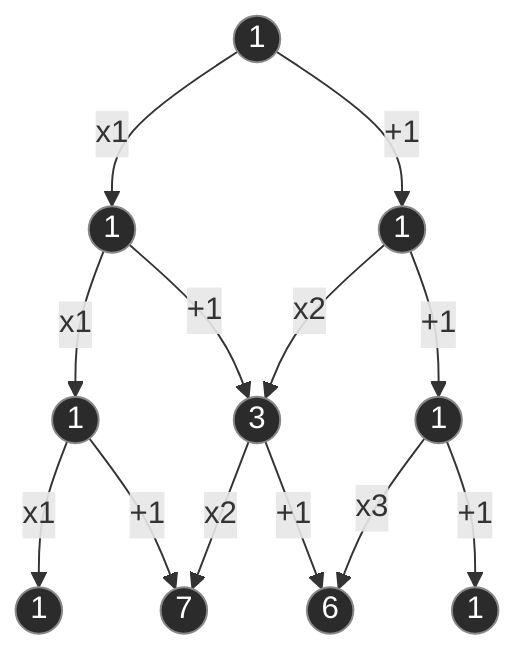

# Partizioni di un Insieme

Una **partizione** di un insieme $A$ (concetto fondamentale sia in [[Basi_del_Calcolo_Combinatorio|combinatoria]] sia nella decomposizione di eventi in [[Spazi_di_Probabilita]]) è una suddivisione dell'insieme in sottoinsiemi (chiamati **blocchi**) che sono a due a due disgiunti e la cui unione restituisce l'insieme $A$ originario (per gli esercizi applicativi si veda [[Esercitazione_04_09-Ottobre]] e il mazzo [[01-Partizioni_di_un_Insieme]]).

## Dettagli Teorici

> [!summary] Definizione: Partizione di un Insieme e Blocchi
> Dal punto di vista formale, una **partizione** dell'insieme $A$ è una collezione di sottoinsiemi $\{A_1, A_2, \dots\}$ (finita o infinita), detti **blocchi**, tali che:
> 1. **Disgiunti a due a due**: Non devono esserci elementi in comune tra due blocchi distinti. Formalmente: $A_{\textcolor{darkgreen}{i}} \cap A_{\textcolor{darkgreen}{j}} = \emptyset$ per ogni $\textcolor{darkgreen}{i} \neq \textcolor{darkgreen}{j}$.
> 2. **Copertura totale**: L'unione di tutti questi sottoinsiemi deve restituire esattamente l'intero insieme di partenza $A$. Formalmente: $\bigcup_{\textcolor{darkgreen}{i}} A_{\textcolor{darkgreen}{i}} = A$.
> 3. **Non vuoti**: I sottoinsiemi non possono essere vuoti. Formalmente: $A_{\textcolor{darkgreen}{i}} \neq \emptyset$.

### Nomenclatura Importante
- I sottoinsiemi $A_{\textcolor{darkgreen}{i}}$ prendono il nome di **blocchi**. 
- È un errore grave in sede d'esame confondere i "blocchi" chiamandoli "partizioni". La *partizione* è l'intera collezione (la suddivisione nel suo complesso), mentre i *blocchi* ne sono semplicemente gli elementi costituenti.
- L'ordine con cui si elencano i blocchi è irrilevante (a differenza delle partizioni ordinate viste in [[Combinazioni_con_Ripetizione_e_Fibonacci]]).

### Esempi Pratici

**Insiemi finiti:**
Dato l'insieme $A = \{1, 2, 3\}$, le partizioni possibili sono $5$. Esiste sempre la partizione con un unico blocco e la partizione con singoli elementi:
- $\{1, 2, 3\}$ (un unico blocco)
- $\{1\}, \{2\}, \{3\}$ (ogni elemento forma un blocco)

In aggiunta a queste, troviamo le partizioni non banali:
- $\{1, 2\}, \{3\}$
- $\{1, 3\}, \{2\}$
- $\{2, 3\}, \{1\}$

**Insiemi infiniti:**
Dato l'insieme dei numeri interi $\mathbb{Z}$ (insieme numerabile studiato in [[Insiemi_e_Cardinalità]]), ci sono svariati modi per partizionarlo:
- **Partizione in due blocchi (finiti nel numero ma di dimensione infinita):** Numeri Pari e Numeri Dispari.
- **Partizione in infiniti blocchi (ciascuno finito):** segmenti di $100$ numeri contigui (es. $\dots, [-99, 0], [1, 100], [101, 200], \dots$).
- **Partizione in infiniti blocchi (ciascuno infinito):** raggruppamento in base alle potenze di un singolo numero primo. Ad esempio un blocco per le potenze di $2$, uno per le potenze di $3$, e un blocco residuale per i numeri che non sono potenze di alcun numero primo.

---

## Calcolo delle Partizioni

Come anticipato, in combinatoria ci si concentra su insiemi finiti di cardinalità $\textcolor{blue}{n}$. Quante sono, in totale, le partizioni possibili di un tale insieme? E quante sono se fissiamo a priori il numero di blocchi $\textcolor{purple}{k}$?

### I Numeri di Bell ($B_{\textcolor{blue}{n}}$)

> [!summary] Definizione: Numeri di Bell
> Il numero totale di partizioni di un insieme di $\textcolor{blue}{n}$ elementi (senza fissare il numero di blocchi) è detto **Numero di Bell** e si indica con $B_{\textcolor{blue}{n}}$:
> - $B_0 = 1$ per convenzione (l'unica partizione dell'insieme vuoto è la partizione vuota).
> - $B_1 = 1$ (una sola partizione possibile per $1$ elemento).
> - $B_2 = 2$ (due partizioni: un blocco da $2$, o due blocchi da $1$).
> - $B_3 = 5$.

> [!info] Proposizione: Formula Ricorsiva per i Numeri di Bell
> I numeri di Bell soddisfano la relazione ricorsiva:
> $$B_{\textcolor{blue}{n}} = \sum_{\textcolor{darkgreen}{h}=0}^{\textcolor{blue}{n}-1} \binom{\textcolor{blue}{n}-1}{\textcolor{darkgreen}{h}} B_{\textcolor{darkgreen}{h}}$$

> [!quote] Dimostrazione
> Fissiamo l'attenzione sull'ultimo elemento $\textcolor{blue}{n}$ dell'insieme $\{1, \dots, \textcolor{blue}{n}\}$ e classifichiamo le partizioni in base a quanti elementi *non* appartengono al blocco di $\textcolor{blue}{n}$. Se rimangono fuori dal blocco di $\textcolor{blue}{n}$ esattamente $\textcolor{darkgreen}{h}$ elementi (con $0 \le \textcolor{darkgreen}{h} \le \textcolor{blue}{n}-1$), possiamo scegliere quali sono questi $\textcolor{darkgreen}{h}$ elementi tra i restanti $\textcolor{blue}{n}-1$ in $\binom{\textcolor{blue}{n}-1}{\textcolor{darkgreen}{h}}$ modi (tramite le [[Disposizioni_e_Combinazioni|combinazioni semplici]]), e poi partizionare liberamente tali $\textcolor{darkgreen}{h}$ elementi in $B_{\textcolor{darkgreen}{h}}$ modi. Sommando su tutti i possibili valori di $\textcolor{darkgreen}{h}$ si ottiene la tesi.

Per agevolare i conti a mano, si sfrutta una costruzione tabellare chiamata **Triangolo di Bell** (concettualmente simile al Triangolo di Tartaglia):
- Ogni riga inizia con l'ultimo numero della riga precedente.
- Ogni numero successivo nella stessa riga è la somma del numero alla sua sinistra e di quello immediatamente sopra a quest'ultimo.
- Sulla prima colonna (e sull'ultima diagonale) si generano i Numeri di Bell in sequenza.

| $\textcolor{blue}{n}=1$ | $\textcolor{blue}{n}=2$ | $\textcolor{blue}{n}=3$ | $\textcolor{blue}{n}=4$ | $\textcolor{blue}{n}=5$ |
| :---: | :---: | :---: | :---: | :---: |
| **1** | | | | |
| **1** | 2 | | | |
| **2** | 3 | 5 | | |
| **5** | 7 | 10 | 15 | |
| **15** | 20 | 27 | 37 | 52 |

**Regole di costruzione del Triangolo:**
Indicando con $b_{\textcolor{darkgreen}{i},\textcolor{darkgreen}{j}}$ l'elemento di riga $\textcolor{darkgreen}{i}$ e colonna $\textcolor{darkgreen}{j}$ (partendo da zero), le due formule per ricavare i numeri sono:
- **Riporto di fine riga:** $b_{\textcolor{darkgreen}{i},0} = b_{\textcolor{darkgreen}{i}-1,\textcolor{darkgreen}{i}-1}$ *(il primo elemento della riga è l'ultimo della riga precedente)*
- **Somma interna:** $b_{\textcolor{darkgreen}{i},\textcolor{darkgreen}{j}} = b_{\textcolor{darkgreen}{i},\textcolor{darkgreen}{j}-1} + b_{\textcolor{darkgreen}{i}-1,\textcolor{darkgreen}{j}-1}$ *(un elemento si ottiene sommando quello alla sua sinistra con quello in alto a sinistra)*

> *I **Numeri di Bell** si trovano nella prima colonna (evidenziata in grassetto).*

### I Numeri di Stirling di Seconda Specie ($S_{\textcolor{blue}{n},\textcolor{purple}{k}}$)

> [!summary] Definizione: Numeri di Stirling di Seconda Specie
> Il numero di partizioni di un insieme di $\textcolor{blue}{n}$ elementi in **esattamente $\textcolor{purple}{k}$ blocchi** (con $1 \le \textcolor{purple}{k} \le \textcolor{blue}{n}$) è detto **Numero di Stirling di Seconda Specie** e si indica con $S_{\textcolor{blue}{n},\textcolor{purple}{k}}$.
> Casi base notevoli:
> - $S_{\textcolor{blue}{n},1} = 1$ (c'è un solo modo di mettere $\textcolor{blue}{n}$ elementi in un unico grande blocco).
> - $S_{\textcolor{blue}{n},\textcolor{blue}{n}} = 1$ (c'è un solo modo di formare $\textcolor{blue}{n}$ blocchi, ovvero un elemento per blocco).
> - $B_{\textcolor{blue}{n}} = \sum_{\textcolor{purple}{k}=1}^{\textcolor{blue}{n}} S_{\textcolor{blue}{n},\textcolor{purple}{k}}$.

*(Nota: i numeri di Stirling di prima specie non fanno parte del programma del corso).*

> [!info] Proposizione: Formula Esplicita e Formula Ricorsiva per i Numeri di Stirling
> 1. **Formula Esplicita (tramite Sequenze $\textcolor{purple}{k}$-piene):**
>    $$S_{\textcolor{blue}{n},\textcolor{purple}{k}} = \frac{1}{\textcolor{purple}{k}!} \sum_{\textcolor{darkgreen}{i}=0}^{\textcolor{purple}{k}} (-1)^{\textcolor{darkgreen}{i}} \binom{\textcolor{purple}{k}}{\textcolor{darkgreen}{i}} (\textcolor{purple}{k}-\textcolor{darkgreen}{i})^{\textcolor{blue}{n}}$$
> 2. **Formula Ricorsiva (Triangolo di Stirling):**
>    $$S_{\textcolor{blue}{n},\textcolor{purple}{k}} = S_{\textcolor{blue}{n}-1, \textcolor{purple}{k}-1} + \textcolor{purple}{k} \cdot S_{\textcolor{blue}{n}-1, \textcolor{purple}{k}}$$

> [!quote] Dimostrazione
> 1. **Per la formula esplicita:** una sequenza $\textcolor{purple}{k}$-piena di lunghezza $\textcolor{blue}{n}$ sull'alfabeto $\{1, \dots, \textcolor{purple}{k}\}$ (calcolata con il [[Principio_di_Inclusione_Esclusione]]) individua una partizione di $\{1, \dots, \textcolor{blue}{n}\}$ in $\textcolor{purple}{k}$ blocchi *etichettati/ordinati* (dove il blocco $r$ contiene le posizioni in cui compare il simbolo $r$). Poiché in una partizione l'ordine dei $\textcolor{purple}{k}$ blocchi non conta, applicando una funzione $\textcolor{purple}{k}!$-a-$1$ si divide il numero delle sequenze $\textcolor{purple}{k}$-piene per $\textcolor{purple}{k}!$.
> 2. **Per la formula ricorsiva:** isoliamo l'elemento $\textcolor{blue}{n}$. Tutte le partizioni in $\textcolor{purple}{k}$ blocchi si dividono in due casi disgiunti:
>    - L'elemento $\textcolor{blue}{n}$ forma un blocco singoletto $\{\textcolor{blue}{n}\}$ da solo: i restanti $\textcolor{blue}{n}-1$ elementi devono essere partizionati in $\textcolor{purple}{k}-1$ blocchi ($S_{\textcolor{blue}{n}-1, \textcolor{purple}{k}-1}$ modi).
>    - L'elemento $\textcolor{blue}{n}$ si unisce a uno dei $\textcolor{purple}{k}$ blocchi già formati dai primi $\textcolor{blue}{n}-1$ elementi: ci sono $S_{\textcolor{blue}{n}-1, \textcolor{purple}{k}}$ modi di formare i $\textcolor{purple}{k}$ blocchi e $\textcolor{purple}{k}$ scelte su quale blocco ospiterà $\textcolor{blue}{n}$ ($\textcolor{purple}{k} \cdot S_{\textcolor{blue}{n}-1, \textcolor{purple}{k}}$ modi).

Da questa ricorsione si costruisce il **Triangolo di Stirling**, in cui i calcoli avvengono scendendo di riga in riga similmente a Tartaglia, ma moltiplicando opportunamente per $\textcolor{purple}{k}$.

---

## 📝 Domande di Verifica

> [!question]- Cos'è una partizione? (Domanda d'esame frequente, x4)
> **Risposta:**
> Una partizione di un insieme $A$ è una collezione di suoi sottoinsiemi, chiamati **blocchi**, che soddisfano tre proprietà fondamentali:
> 1. Sono a due a due disgiunti ($A_{\textcolor{darkgreen}{i}} \cap A_{\textcolor{darkgreen}{j}} = \emptyset$ per $\textcolor{darkgreen}{i} \neq \textcolor{darkgreen}{j}$).
> 2. La loro unione ricopre tutto l'insieme di partenza ($\bigcup_{\textcolor{darkgreen}{i}} A_{\textcolor{darkgreen}{i}} = A$).
> 3. Nessun blocco è vuoto ($A_{\textcolor{darkgreen}{i}} \neq \emptyset$).

> [!question]- Cosa sono i numeri di Bell? Come si calcolano ricorsivamente e col Triangolo di Bell? (x4)
> **Risposta:**
> Il numero di Bell $B_{\textcolor{blue}{n}}$ indica il numero totale di partizioni di un insieme di $\textcolor{blue}{n}$ elementi (con $B_0 = 1, B_1 = 1, B_2 = 2, B_3 = 5$).
> Si calcola ricorsivamente tramite la formula:
> $$B_{\textcolor{blue}{n}} = \sum_{\textcolor{darkgreen}{h}=0}^{\textcolor{blue}{n}-1} \binom{\textcolor{blue}{n}-1}{\textcolor{darkgreen}{h}} B_{\textcolor{darkgreen}{h}}$$
> Operativamente si può usare il **Triangolo di Bell**, ponendo $b_{1,1} = 1$, riportando a inizio riga l'ultimo elemento della riga precedente ($b_{\textcolor{darkgreen}{i},0} = b_{\textcolor{darkgreen}{i}-1,\textcolor{darkgreen}{i}-1}$) e sommando l'elemento a sinistra con quello in alto a sinistra ($b_{\textcolor{darkgreen}{i},\textcolor{darkgreen}{j}} = b_{\textcolor{darkgreen}{i},\textcolor{darkgreen}{j}-1} + b_{\textcolor{darkgreen}{i}-1,\textcolor{darkgreen}{j}-1}$).

> [!question]- Cosa sono i numeri di Stirling di seconda specie? Quali sono la formula ricorsiva e la formula esplicita? (x4)
> **Risposta:**
> Il numero di Stirling $S_{\textcolor{blue}{n},\textcolor{purple}{k}}$ rappresenta il numero di partizioni di un insieme di $\textcolor{blue}{n}$ elementi in esattamente $\textcolor{purple}{k}$ blocchi non vuoti.
> - **Formula ricorsiva:** $S_{\textcolor{blue}{n},\textcolor{purple}{k}} = S_{\textcolor{blue}{n}-1,\textcolor{purple}{k}-1} + \textcolor{purple}{k} \cdot S_{\textcolor{blue}{n}-1,\textcolor{purple}{k}}$ (con $S_{\textcolor{blue}{n},1} = S_{\textcolor{blue}{n},\textcolor{blue}{n}} = 1$).
> - **Formula esplicita (dalle sequenze $\textcolor{purple}{k}$-piene divise per $\textcolor{purple}{k}!$):**
>   $$S_{\textcolor{blue}{n},\textcolor{purple}{k}} = \frac{1}{\textcolor{purple}{k}!} \sum_{\textcolor{darkgreen}{i}=0}^{\textcolor{purple}{k}} (-1)^{\textcolor{darkgreen}{i}} \binom{\textcolor{purple}{k}}{\textcolor{darkgreen}{i}} (\textcolor{purple}{k}-\textcolor{darkgreen}{i})^{\textcolor{blue}{n}}$$

