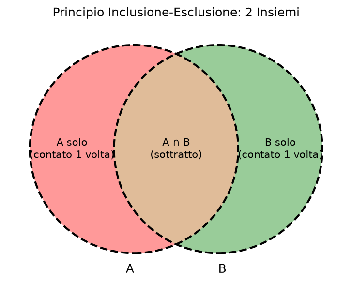
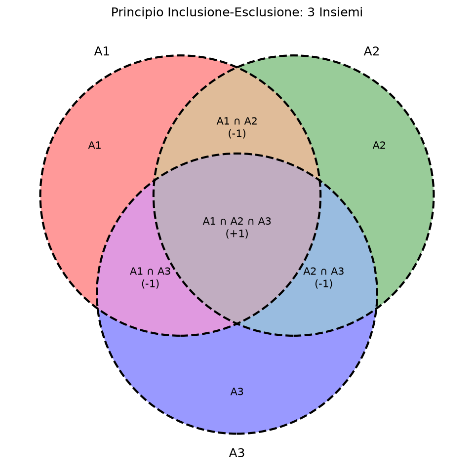

# Principio di Inclusione-Esclusione, Sequenze k-piene e Scombussolamenti

Questa pagina illustra il Principio di Inclusione-Esclusione, un metodo fondamentale per calcolare la cardinalità dell'unione di più insiemi. Vengono inoltre presentate due applicazioni pratiche: il calcolo delle sequenze k-piene e degli scombussolamenti (derangements).

## Il Principio di Inclusione-Esclusione per 2 e 3 insiemi

Nella versione più semplice, quando abbiamo solo due insiemi $A$ e $B$, ci chiediamo quanti elementi ci sono nell'unione. Sicuramente ci possono essere delle sovrapposizioni tra i due insiemi.

Se vogliamo calcolare la cardinalità dell'unione $|A \cup B|$, sommare semplicemente $|A| + |B|$ non funziona, perché gli elementi che stanno nell'intersezione $A \cap B$ verrebbero contati due volte. Per correggere la formula, basta sottrarre il numero degli elementi dell'intersezione:
$$|A \cup B| = |A| + |B| - |A \cap B|$$

Nel caso con tre insiemi $A_1$, $A_2$ e $A_3$, sommiamo prima le cardinalità dei singoli insiemi, poi sottraiamo le intersezioni a due a due per bilanciare gli elementi contati più volte, e infine ri-aggiungiamo l'intersezione a tre perché era stata prima contata tre volte e poi sottratta tre volte:
$$|A_1 \cup A_2 \cup A_3| = |A_1| + |A_2| + |A_3| - |A_1 \cap A_2| - |A_1 \cap A_3| - |A_2 \cap A_3| + |A_1 \cap A_2 \cap A_3|$$

In sintesi, includiamo le cardinalità singole, escludiamo le intersezioni a due a due, e includiamo di nuovo le intersezioni a tre a tre.

### Esempio Pratico: Multipli di 2, 3 e 5

Vogliamo calcolare quanti sono i numeri interi tra 1 e 240 che sono divisibili per 2, per 3 o per 5. 
Definiamo tre insiemi:
- $A$: multipli di 2 ($240/2 = 120$)
- $B$: multipli di 3 ($240/3 = 80$)
- $C$: multipli di 5 ($240/5 = 48$)

Intersezioni a due a due:
- $A \cap B$: multipli di 6 ($240/6 = 40$)
- $A \cap C$: multipli di 10 ($240/10 = 24$)
- $B \cap C$: multipli di 15 ($240/15 = 16$)

Intersezione a tre:
- $A \cap B \cap C$: multipli di 30 ($240/30 = 8$)

Sostituendo nella formula:
$$120 + 80 + 48 - 40 - 24 - 16 + 8 = 176$$
Ci sono 176 numeri tra 1 e 240 che sono multipli di 2, 3 o 5.

## La Formula Generale per n Insiemi

> [!info] Teorema: Principio di Inclusione-Esclusione
> Per $\textcolor{blue}{n}$ insiemi, la cardinalità dell'unione si ottiene sommando le cardinalità degli insiemi presi 1 a 1, sottraendo le intersezioni a 2 a 2, risommando quelle a 3 a 3, e così via alternando i segni.
> $$ \left|\bigcup_{\textcolor{darkgreen}{i}=1}^{\textcolor{blue}{n}} A_{\textcolor{darkgreen}{i}}\right| = \sum_{\textcolor{purple}{I} \subseteq \{1,\dots,\textcolor{blue}{n}\}, \textcolor{purple}{I} \neq \emptyset} (-1)^{|\textcolor{purple}{I}|-1} \left|\bigcap_{\textcolor{darkgreen}{i} \in \textcolor{purple}{I}} A_{\textcolor{darkgreen}{i}}\right| $$

Spesso siamo interessati al complementare dell'unione rispetto a un certo universo $U$. Calcolare gli elementi che stanno nel complementare dell'unione, ovvero che non appartengono a nessun insieme $A_{\textcolor{darkgreen}{i}}$, è dato da:
$$ \left| \left(\bigcup_{\textcolor{darkgreen}{i}=1}^{\textcolor{blue}{n}} A_{\textcolor{darkgreen}{i}}\right)^c \right| = |U| - \left|\bigcup_{\textcolor{darkgreen}{i}=1}^{\textcolor{blue}{n}} A_{\textcolor{darkgreen}{i}}\right| $$

Unendo il termine per l'insieme vuoto ($\textcolor{purple}{I} = \emptyset$), per il quale intersezione vuota equivale all'universo $U$, la formula si semplifica in:
$$ \left| \bigcap_{\textcolor{darkgreen}{i}=1}^{\textcolor{blue}{n}} A_{\textcolor{darkgreen}{i}}^c \right| = \sum_{\textcolor{purple}{I} \subseteq \{1,\dots,\textcolor{blue}{n}\}} (-1)^{|\textcolor{purple}{I}|} \left|\bigcap_{\textcolor{darkgreen}{i} \in \textcolor{purple}{I}} A_{\textcolor{darkgreen}{i}}\right| $$

## Applicazione: Sequenze k-piene

> [!summary] Definizione: Sequenza k-piena
> Una sequenza di lunghezza $\textcolor{blue}{n}$ con coefficienti scelti in un alfabeto di dimensione $\textcolor{magenta}{k}$ si dice "**$\textcolor{magenta}{k}$-piena**" se contiene tutti i numeri da $1$ a $\textcolor{magenta}{k}$ almeno una volta.

Sia $U$ l'universo di tutte le sequenze di lunghezza $\textcolor{blue}{n}$ a valori in $\{1, \dots, \textcolor{magenta}{k}\}$, che sono in totale $\textcolor{magenta}{k}^{\textcolor{blue}{n}}$.
Definiamo $A_{\textcolor{darkgreen}{i}}$ come l'insieme delle sequenze che *non contengono* il numero $\textcolor{darkgreen}{i}$. Le sequenze $\textcolor{magenta}{k}$-piene sono il complementare dell'unione degli $A_{\textcolor{darkgreen}{i}}$.

> [!quote] Dimostrazione del conteggio
> L'intersezione di $\textcolor{darkgreen}{i}$ insiemi (ovvero sequenze a cui mancano $\textcolor{darkgreen}{i}$ elementi specifici) avrà cardinalità $(\textcolor{magenta}{k}-\textcolor{darkgreen}{i})^{\textcolor{blue}{n}}$. I modi di scegliere queste intersezioni, ovvero gli elementi mancanti, sono le combinazioni $\binom{\textcolor{magenta}{k}}{\textcolor{darkgreen}{i}}$.
> Applicando il principio di inclusione-esclusione sul complementare dell'unione, le sequenze $\textcolor{magenta}{k}$-piene sono date da:
> $$ \sum_{\textcolor{darkgreen}{i}=0}^{\textcolor{magenta}{k}} (-1)^{\textcolor{darkgreen}{i}} \binom{\textcolor{magenta}{k}}{\textcolor{darkgreen}{i}} (\textcolor{magenta}{k}-\textcolor{darkgreen}{i})^{\textcolor{blue}{n}} $$

## Applicazione: Scombussolamenti (Derangements)

> [!summary] Definizione: Scombussolamento (Derangement)
> Uno "**scombussolamento**" è una permutazione di $\textcolor{blue}{n}$ elementi in cui **nessun** elemento si trova nella sua posizione originaria.

L'universo $U$ è l'insieme di tutte le permutazioni di $\textcolor{blue}{n}$ elementi, la cui cardinalità è $\textcolor{blue}{n}!$. Definiamo $A_{\textcolor{darkgreen}{i}}$ come l'insieme delle permutazioni in cui l'elemento $\textcolor{darkgreen}{i}$ è *nella sua posizione originale*.
Vogliamo contare il numero di scombussolamenti, ovvero le permutazioni che non appartengono a nessun $A_{\textcolor{darkgreen}{i}}$.

> [!quote] Dimostrazione del conteggio
> L'intersezione di $\textcolor{darkgreen}{i}$ insiemi $A$ significa fissare $\textcolor{darkgreen}{i}$ elementi al loro posto e lasciare liberi di permutare i restanti $\textcolor{blue}{n}-\textcolor{darkgreen}{i}$ elementi, il che genera $(\textcolor{blue}{n}-\textcolor{darkgreen}{i})!$ permutazioni. Ci sono $\binom{\textcolor{blue}{n}}{\textcolor{darkgreen}{i}}$ possibili scelte per fissare $\textcolor{darkgreen}{i}$ elementi.
> Il numero totale di scombussolamenti diventa quindi:
> $$ \sum_{\textcolor{darkgreen}{i}=0}^{\textcolor{blue}{n}} (-1)^{\textcolor{darkgreen}{i}} \binom{\textcolor{blue}{n}}{\textcolor{darkgreen}{i}} (\textcolor{blue}{n}-\textcolor{darkgreen}{i})! $$

Espandendo il coefficiente binomiale $\binom{\textcolor{blue}{n}}{\textcolor{darkgreen}{i}} = \frac{\textcolor{blue}{n}!}{\textcolor{darkgreen}{i}!(\textcolor{blue}{n}-\textcolor{darkgreen}{i})!}$, la formula si semplifica elegantemente in:
$$ \textcolor{blue}{n}! \sum_{\textcolor{darkgreen}{i}=0}^{\textcolor{blue}{n}} \frac{(-1)^{\textcolor{darkgreen}{i}}}{\textcolor{darkgreen}{i}!} $$

---

## 📝 Domande di Verifica

> [!question]- Spiegami il principio di inclusione-esclusione. (x3)
> **Risposta:**
> Vogliamo calcolare la cardinalità dell’unione di $\textcolor{blue}{n}$ insiemi. Sommiamo quindi la cardinalità dei singoli insiemi. Togliamo poi tutti quelli che erano comuni a due insieme (ovvero gli elementi nell’intersezione), perchè contati due volte. Vanno poi aggiunti di nuovo gli elementi in comune a tre insiemi, che abbiamo tolto due volte nella scorsa operazione e cosí via. La formula è la seguente:
> $$ \left|\bigcup_{\textcolor{darkgreen}{i}=1}^{\textcolor{blue}{n}} A_{\textcolor{darkgreen}{i}}\right| = \sum_{\emptyset \neq \textcolor{purple}{S} \subseteq \{1\dots \textcolor{blue}{n}\}} (-1)^{|\textcolor{purple}{S}|+1}\left|\bigcap_{\textcolor{darkgreen}{i} \in \textcolor{purple}{S}} A_{\textcolor{darkgreen}{i}}\right| $$

> [!question]- Cos’è uno scombussolamento? (x2)
> **Risposta:**
> Uno scombussolamento è una permutazione in cui nessun elemento rimane al suo posto. Per esempio (3 2 1 4) è uno scombussolamento. Il numero di scombussolamenti di lunghezza $\textcolor{blue}{n}$ è:
> $$ \sum_{\textcolor{green}{i}=0}^{\textcolor{blue}{n}} (-1)^{\textcolor{green}{i}} (\textcolor{blue}{n})_{\textcolor{blue}{n}-\textcolor{green}{i}} $$
> Che si può anche scrivere (usando i fattoriali) come:
> $$ \textcolor{blue}{n}! \sum_{\textcolor{green}{i}=0}^{\textcolor{blue}{n}} \frac{(-1)^{\textcolor{green}{i}}}{\textcolor{green}{i}!} $$
